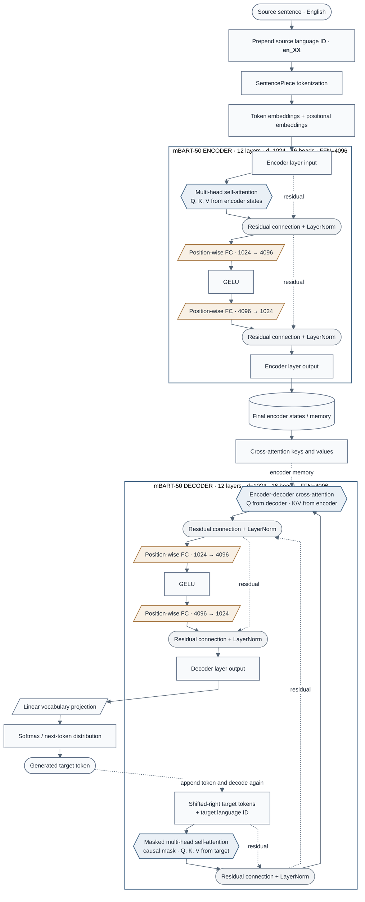
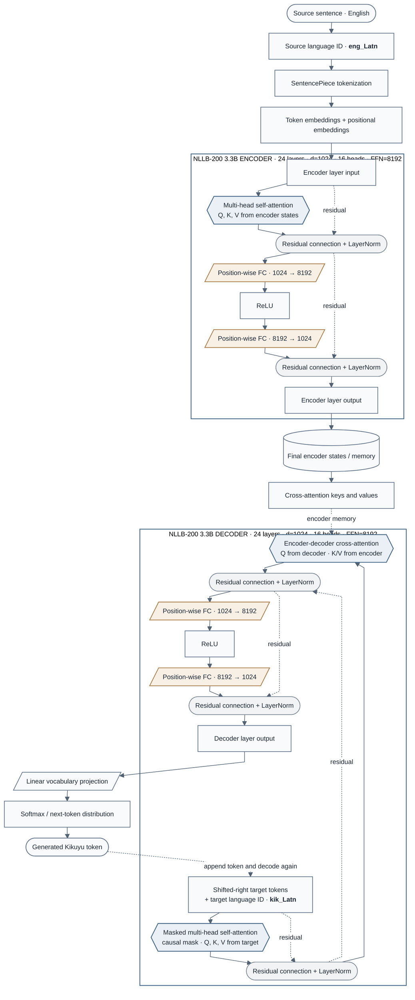

# Vertical Transformer Architecture: mBART-50 and NLLB-200

Compact, vertically arranged schematics of the encoder-decoder Transformer used by the named translation checkpoints. The diagrams separate the encoder and decoder stacks, show the canonical sublayer order, and include residual connections, layer normalization, attention, position-wise feed-forward layers, and language-tagged data flow. Each block shown is a representative layer repeated to the depth specified.

> **Architecture scope.** “Exact” here means the standard Transformer layer structure and checkpoint dimensions/depths. Implementation details such as normalization placement, dropout, embedding sharing, and generation configuration can vary by checkpoint and library version. Confirm the linked model configuration when reproducing results.

## Legend

- **Blue hexagon:** multi-head attention (MHA)
- **Amber parallelogram:** position-wise fully connected feed-forward network (FFN)
- **Gray rounded node:** residual addition and layer normalization
- **Dashed arrow:** encoder memory supplied to decoder cross-attention
- **Repeated layer count:** number of encoder or decoder layers in that checkpoint

## mBART-50 many-to-many

This checkpoint has 12 encoder layers and 12 decoder layers, model dimension 1024, 16 attention heads, FFN dimension 4096, and GELU activation. English is identified with `en_XX`. mBART-50 covers 50 languages and does **not** include Kikuyu.

## NLLB-200 3.3B

This checkpoint has 24 encoder layers and 24 decoder layers, model dimension 1024, 16 attention heads, FFN dimension 8192, and ReLU activation. The source and target direction is encoded with NLLB language tags: `eng_Latn` → `kik_Latn`. NLLB-200 includes Kikuyu among its supported languages.

## Checkpoint summary

| Checkpoint | Languages | Parameters (approx.) | Encoder / decoder layers | d_model / heads / FFN dimension | FFN activation |
|---|---:|---:|---:|---:|---|
| [mBART-50 many-to-many](https://huggingface.co/facebook/mbart-large-50-many-to-many-mmt) | 50 | 610M | 12 / 12 | 1024 / 16 / 4096 | GELU |
| [NLLB-200 3.3B](https://huggingface.co/facebook/nllb-200-3.3B) | 200 | 3.3B | 24 / 24 | 1024 / 16 / 8192 | ReLU |

NLLB-200 also has smaller checkpoint variants, including distilled 600M and 1.3B models. Values above refer only to the named checkpoints; check the exact configuration for reproduction.

## Zero-shot interpretation

Language tags tell the model which direction to translate, while the encoder represents the source and decoder generates target tokens autoregressively. Tags do not create language knowledge absent from training. mBART-50 does not support Kikuyu; NLLB-200 includes it, but coverage alone does not ensure every direction is well represented. The example's French output and repeated mBART output should be interpreted alongside checkpoint support, tokenizer and language IDs, generation settings, and reference quality—not as evidence that one architectural block alone caused the result.

## References

- [mBART-50 many-to-many model card](https://huggingface.co/facebook/mbart-large-50-many-to-many-mmt)
- [mBART-50 configuration](https://huggingface.co/facebook/mbart-large-50-many-to-many-mmt/blob/main/config.json)
- [NLLB-200 3.3B model card](https://huggingface.co/facebook/nllb-200-3.3B)
- [NLLB-200 3.3B configuration](https://huggingface.co/facebook/nllb-200-3.3B/blob/main/config.json)
- Vaswani et al., [Attention Is All You Need](https://arxiv.org/abs/1706.03762)
- Tang et al., [Multilingual Translation with Extensible Multilingual Pretraining and Finetuning](https://arxiv.org/abs/2008.00401)
- NLLB Team et al., [No Language Left Behind: Scaling Human-Centered Machine Translation](https://arxiv.org/abs/2207.04672)
