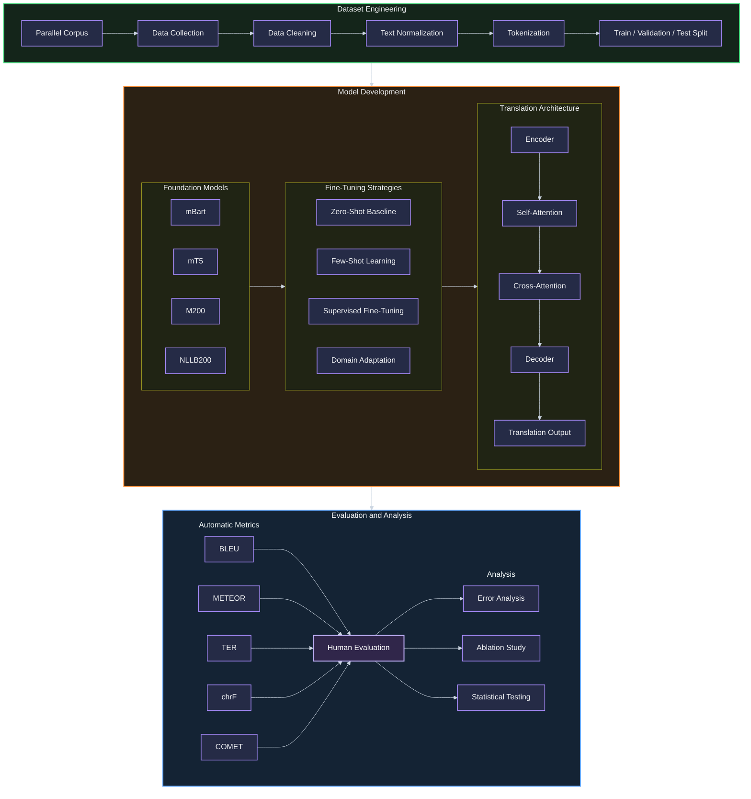

# Machine Translation Seminar: End-to-End Workflow

This diagram summarizes the machine-translation workflow from parallel-corpus preparation through model development and evaluation.

> Evaluation metrics and human assessment inform error analysis, ablation studies, and statistical testing.
