# Machine Translation End-to-End Workflow

This diagram follows an end-to-end machine translation pipeline with offline data preparation and model development at the top, and online translation and evaluation below.

```mermaid
%%{init: {"theme": "base", "themeVariables": {"fontFamily": "Georgia, serif", "fontSize": "18px", "primaryTextColor": "#172033", "lineColor": "#344054", "background": "#ffffff"}, "flowchart": {"curve": "basis", "htmlLabels": true, "nodeSpacing": 42, "rankSpacing": 52}}}%%
flowchart LR

  subgraph OFFLINE["1) Data Preparation &amp; Model Development (Offline)"]
    direction LR
    CORPUS["Parallel Corpus"]
    CHUNK["Data Collection<br/>&amp; Cleaning"]
    EMBED_DOC["Text<br/>Normalization"]
    VECTOR[("Tokenization<br/>&amp; Train/Validation/Test Split")]

    CORPUS --> CHUNK --> EMBED_DOC --> VECTOR
  end

  subgraph ONLINE["2) Translation &amp; Evaluation (Online)"]
    direction LR
    SOURCE["Source<br/>Text"]
    TOKENIZE["Source Text<br/>Tokenization"]
    FILTER["(Optional)<br/>Domain / Style Filtering"]
    SEARCH["Foundation Model<br/>or Fine-Tuned Model"]
    RETRIEVE["Translation<br/>Candidates"]
    RERANK["(Optional)<br/>Re-ranking"]
    CONTEXT["Encoder-Decoder<br/>Architecture"]
    ANSWER["Generated<br/>Translation"]

    SOURCE --> TOKENIZE --> FILTER --> SEARCH --> RETRIEVE --> RERANK --> CONTEXT --> ANSWER
  end

  VECTOR -.-> SEARCH

  classDef stage fill:#fff8f1,stroke:#f2a86b,color:#172033,stroke-width:1.8px;
  classDef process fill:#f5efff,stroke:#9b72c4,color:#172033,stroke-width:1.8px;
  classDef storage fill:#edf6ff,stroke:#527da8,color:#172033,stroke-width:1.8px;
  classDef result fill:#fff8f1,stroke:#ef9a58,color:#172033,stroke-width:1.8px;

  class CORPUS,CHUNK,EMBED_DOC,SOURCE,TOKENIZE stage;
  class FILTER,SEARCH,RERANK process;
  class VECTOR storage;
  class RETRIEVE,CONTEXT,ANSWER result;

  style OFFLINE fill:#ffffff,stroke:#ffffff,stroke-width:0px,color:#172033
  style ONLINE fill:#ffffff,stroke:#ffffff,stroke-width:0px,color:#172033

  linkStyle default stroke:#344054,stroke-width:2.5px
```

## Pipeline Summary

### 1. Data Preparation and Model Development

1. **Parallel Corpus**: collect aligned source and target-language text.
2. **Data Collection and Cleaning**: remove noise and unusable records.
3. **Text Normalization**: standardize formatting and language conventions.
4. **Tokenization**: convert text into model-compatible units.
5. Split the dataset into **training, validation, and test** sets.
6. Select foundation models such as **LLaMA, Mistral, Gemma, or Phi**.
7. Apply a suitable strategy: **zero-shot baseline, instruction tuning, supervised fine-tuning, or domain adaptation**.

### 2. Translation and Evaluation

1. **Source Text** is provided as the input.
2. **Source Text Tokenization** converts the input into model tokens.
3. Optional **domain or style filtering** adapts the request to a target context.
4. A **foundation or fine-tuned model** generates one or more translation candidates.
5. Optional **re-ranking** selects the most fluent or contextually accurate output.
6. An **encoder-decoder architecture** performs self-attention and cross-attention when applicable.
7. The **generated translation** is returned as the final answer.

## Evaluation

Evaluate the generated translation using:

- **BLEU**
- **METEOR**
- **TER**
- **chrF**
- **COMET**
- **Human Evaluation**
- **Error Analysis**
- **Ablation Study**
- **Statistical Testing**
