# Multilingual Transformer Architectures: mBART-50 and NLLB-200

**Architecture overview for language-tagged translation and zero-shot evaluation.** The diagrams use a restrained ACL/EMNLP-inspired palette, grouped encoder/decoder containers, uniform directional arrows, and distinct shapes for attention, feed-forward layers, normalization, and data. The drawings show one representative Transformer block and annotate its repetition count for the named checkpoint.

## Figure 1. Language direction and model workflow

```mermaid
%%{init: {"theme":"base","themeVariables":{"background":"#ffffff","mainBkg":"#ffffff","primaryColor":"#ffffff","primaryTextColor":"#1f2937","lineColor":"#526273","fontSize":"13px"},"flowchart":{"htmlLabels":true,"curve":"linear","nodeSpacing":30,"rankSpacing":38}}}%%
flowchart LR
    subgraph INPUTS["(a) Task specification"]
        direction TB
        SRC(["Source sentence<br/>What is the role of carbohydrates in the diet of dairy cattle?"])
        LANGS["Source: English<br/>Target: Kikuyu"]
        SRC --> PACK["Tokenized input + direction tags"]
        LANGS --> PACK
    end

    subgraph MODELS["(b) Multilingual encoder-decoder models"]
        direction TB
        MBART["mBART-50<br/>50 languages · 610M parameters<br/>12 encoder + 12 decoder layers"]
        NLLB["NLLB-200 3.3B<br/>200 languages · 3.3B parameters<br/>24 encoder + 24 decoder layers"]
        PACK --> MBART
        PACK --> NLLB
        MBART --> MOUT["Generated sequence"]
        NLLB --> NOUT["Generated sequence"]
    end

    subgraph EVAL["(c) Interpretation and checks"]
        direction TB
        CHECK["Verify checkpoint support,<br/>source/target codes, tokenizer,<br/>and generation settings"]
        HUMAN["Compare with human reference<br/>and evaluate language, fidelity,<br/>and repetition"]
        CHECK --> HUMAN
    end

    MOUT --> CHECK
    NOUT --> CHECK

    classDef task fill:#f8fafc,stroke:#64748b,color:#1f2937,stroke-width:1.2px;
    classDef model fill:#eef2f7,stroke:#526273,color:#1f2937,stroke-width:1.5px;
    classDef eval fill:#f0f5f1,stroke:#567a64,color:#1f2937,stroke-width:1.2px;
    class SRC,LANGS,PACK task;
    class MBART,NLLB,MOUT,NOUT model;
    class CHECK,HUMAN eval;
    style INPUTS fill:#ffffff,stroke:#94a3b8,stroke-width:1.3px
    style MODELS fill:#ffffff,stroke:#94a3b8,stroke-width:1.3px
    style EVAL fill:#ffffff,stroke:#94a3b8,stroke-width:1.3px
```

## Figure 2. mBART-50 many-to-many architecture

mBART-50 uses 12 encoder and 12 decoder layers, model width 1024, 16 attention heads, and feed-forward width 4096. English uses the mBART language identifier `en_XX`. Kikuyu is not included in the mBART-50 language set, so this checkpoint does not provide a supported Kikuyu target language ID.

```mermaid
%%{init: {"theme":"base","themeVariables":{"background":"#ffffff","mainBkg":"#ffffff","primaryColor":"#ffffff","primaryTextColor":"#1f2937","lineColor":"#526273","fontSize":"12px"},"flowchart":{"htmlLabels":true,"curve":"linear","nodeSpacing":20,"rankSpacing":28}}}%%
flowchart LR
    M_SRC(["Source text<br/>English"]) --> M_ID["Source language ID<br/><b>en_XX</b>"] --> M_TOK["SentencePiece<br/>token IDs"] --> M_EMB["Token + position<br/>embeddings"]

    subgraph M_ENCODER["mBART-50 encoder · 12 repeated layers · d_model=1024"]
        direction LR
        M_EIN["Encoder input"] --> M_EATT{{"Multi-head<br/>self-attention<br/>16 heads"}} --> M_EADD(["Residual +<br/>LayerNorm"])
        M_EADD --> M_EFC1[["FC 1024 → 4096"]] --> M_EACT["GELU"] --> M_EFC2[["FC 4096 → 1024"]] --> M_ENORM(["Residual +<br/>LayerNorm"])
    end
    M_EMB --> M_EIN

    subgraph M_DECODER["mBART-50 decoder · 12 repeated layers · d_model=1024"]
        direction LR
        M_DIN["Target prefix<br/>+ target language ID"] --> M_DATT{{"Masked multi-head<br/>self-attention<br/>16 heads"}} --> M_DADD(["Residual +<br/>LayerNorm"])
        M_DADD --> M_XATT{{"Encoder-decoder<br/>cross-attention<br/>16 heads"}} --> M_XADD(["Residual +<br/>LayerNorm"])
        M_XADD --> M_DFC1[["FC 1024 → 4096"]] --> M_DACT["GELU"] --> M_DFC2[["FC 4096 → 1024"]] --> M_DNORM(["Residual +<br/>LayerNorm"])
    end
    M_ENORM --> M_DIN
    M_ENORM -. "encoder states: keys and values" .-> M_XATT
    M_DNORM --> M_LM[["Vocabulary projection"]] --> M_OUT(["Next target token"])

    classDef token fill:#f8fafc,stroke:#64748b,color:#1f2937,stroke-width:1.2px;
    classDef attention fill:#eaf0f6,stroke:#496a8a,color:#1f2937,stroke-width:1.5px;
    classDef feedforward fill:#f8f0e5,stroke:#a87945,color:#1f2937,stroke-width:1.2px;
    classDef norm fill:#f1f3f5,stroke:#7b8794,color:#1f2937,stroke-width:1.1px;
    class M_SRC,M_ID,M_TOK,M_EMB,M_EIN,M_DIN,M_OUT token;
    class M_EATT,M_DATT,M_XATT attention;
    class M_EFC1,M_EFC2,M_DFC1,M_DFC2,M_LM feedforward;
    class M_EADD,M_ENORM,M_DADD,M_XADD,M_DNORM norm;
    style M_ENCODER fill:#ffffff,stroke:#496a8a,stroke-width:1.6px
    style M_DECODER fill:#ffffff,stroke:#496a8a,stroke-width:1.6px
```

## Figure 3. NLLB-200 3.3B architecture

NLLB-200 3.3B uses 24 encoder and 24 decoder layers, model width 1024, 16 attention heads, and feed-forward width 8192. Its language tags explicitly identify the direction: English `eng_Latn` to Kikuyu `kik_Latn`. Kikuyu is included in NLLB-200's supported language set, although coverage alone does not ensure high quality for a particular direction.

```mermaid
%%{init: {"theme":"base","themeVariables":{"background":"#ffffff","mainBkg":"#ffffff","primaryColor":"#ffffff","primaryTextColor":"#1f2937","lineColor":"#526273","fontSize":"12px"},"flowchart":{"htmlLabels":true,"curve":"linear","nodeSpacing":20,"rankSpacing":28}}}%%
flowchart LR
    N_SRC(["Source text<br/>English"]) --> N_ID["Source language ID<br/><b>eng_Latn</b>"] --> N_TOK["SentencePiece<br/>token IDs"] --> N_EMB["Token + position<br/>embeddings"]

    subgraph N_ENCODER["NLLB-200 3.3B encoder · 24 repeated layers · d_model=1024"]
        direction LR
        N_EIN["Encoder input"] --> N_EATT{{"Multi-head<br/>self-attention<br/>16 heads"}} --> N_EADD(["Residual +<br/>LayerNorm"])
        N_EADD --> N_EFC1[["FC 1024 → 8192"]] --> N_EACT["ReLU"] --> N_EFC2[["FC 8192 → 1024"]] --> N_ENORM(["Residual +<br/>LayerNorm"])
    end
    N_EMB --> N_EIN

    subgraph N_DECODER["NLLB-200 3.3B decoder · 24 repeated layers · d_model=1024"]
        direction LR
        N_DIN["Target prefix<br/>+ target language ID"] --> N_DATT{{"Masked multi-head<br/>self-attention<br/>16 heads"}} --> N_DADD(["Residual +<br/>LayerNorm"])
        N_DADD --> N_XATT{{"Encoder-decoder<br/>cross-attention<br/>16 heads"}} --> N_XADD(["Residual +<br/>LayerNorm"])
        N_XADD --> N_DFC1[["FC 1024 → 8192"]] --> N_DACT["ReLU"] --> N_DFC2[["FC 8192 → 1024"]] --> N_DNORM(["Residual +<br/>LayerNorm"])
    end
    N_ENORM --> N_DIN
    N_ENORM -. "encoder states: keys and values" .-> N_XATT
    N_DIN -. "target language ID: kik_Latn" .-> N_DATT
    N_DNORM --> N_LM[["Vocabulary projection"]] --> N_OUT(["Next Kikuyu token"])

    classDef token fill:#f8fafc,stroke:#64748b,color:#1f2937,stroke-width:1.2px;
    classDef attention fill:#eaf0f6,stroke:#496a8a,color:#1f2937,stroke-width:1.5px;
    classDef feedforward fill:#f8f0e5,stroke:#a87945,color:#1f2937,stroke-width:1.2px;
    classDef norm fill:#f1f3f5,stroke:#7b8794,color:#1f2937,stroke-width:1.1px;
    class N_SRC,N_ID,N_TOK,N_EMB,N_EIN,N_DIN,N_OUT token;
    class N_EATT,N_DATT,N_XATT attention;
    class N_EFC1,N_EFC2,N_DFC1,N_DFC2,N_LM feedforward;
    class N_EADD,N_ENORM,N_DADD,N_XADD,N_DNORM norm;
    style N_ENCODER fill:#ffffff,stroke:#496a8a,stroke-width:1.6px
    style N_DECODER fill:#ffffff,stroke:#496a8a,stroke-width:1.6px
```

## Checkpoint summary

| Checkpoint | Languages | Parameters (approx.) | Encoder / decoder layers | Model width / heads / FFN width |
|---|---:|---:|---:|---:|
| [mBART-50 many-to-many](https://huggingface.co/facebook/mbart-large-50-many-to-many-mmt) | 50 | 610M | 12 / 12 | 1024 / 16 / 4096 |
| [NLLB-200 3.3B](https://huggingface.co/facebook/nllb-200-3.3B) | 200 | 3.3B | 24 / 24 | 1024 / 16 / 8192 |

These are checkpoint-specific values. NLLB-200 also has smaller configurations, including distilled 600M and 1.3B checkpoints. Consult the exact model configuration for reproduction.

## Interpretation

The example outputs—French instead of the Kikuyu reference for NLLB-200, and repetition for mBART—are observations, not proof of a particular architectural cause. Validate the checkpoint, tokenizer, source and target language IDs, decoding settings, and reference. mBART-50 does not include Kikuyu; NLLB-200 does. Yet language coverage, parameter count, and architecture do not guarantee reliable pair-level translation, particularly for sparse or zero-shot directions.

## References

- [mBART-50 many-to-many model card](https://huggingface.co/facebook/mbart-large-50-many-to-many-mmt)
- [mBART-50 configuration](https://huggingface.co/facebook/mbart-large-50-many-to-many-mmt/blob/main/config.json)
- [NLLB-200 3.3B model card](https://huggingface.co/facebook/nllb-200-3.3B)
- [NLLB-200 3.3B configuration](https://huggingface.co/facebook/nllb-200-3.3B/blob/main/config.json)
- Tang et al., [Multilingual Translation with Extensible Multilingual Pretraining and Finetuning](https://arxiv.org/abs/2008.00401)
- NLLB Team et al., [No Language Left Behind: Scaling Human-Centered Machine Translation](https://arxiv.org/abs/2207.04672)
