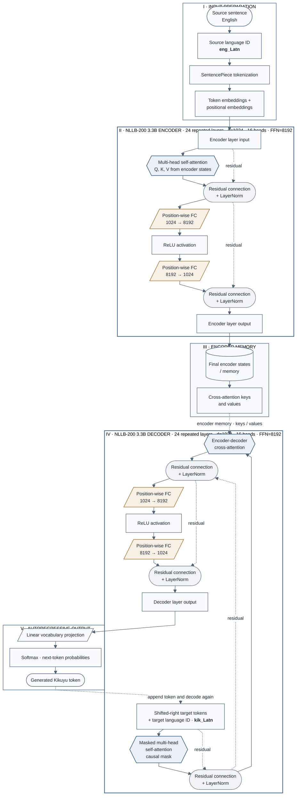

# Compartmentalized Transformer Architectures for Multilingual Translation

This document redraws mBART-50 and NLLB-200 as compartmentalized, vertically flowing architectures. Each model is divided into three clear stages for both encoder and decoder:

1. **Input preparation** — sentence, language ID, tokenization, and embeddings.
2. **Transformer stack** — attention, residual + normalization, feed-forward network, and repeated layers.
3. **Memory / generation** — encoder memory is explicitly connected to decoder cross-attention; decoder output is projected to vocabulary probabilities and generated autoregressively.

The restrained navy, slate, and amber palette, grouped containers, consistent arrows, and distinct operation symbols are designed for an academic-paper figure. The checkpoint dimensions and depths below are model-specific.

## Visual key

- **Blue hexagon:** multi-head attention.
- **Amber parallelogram:** position-wise fully connected (FC) layer.
- **Gray rounded container:** residual connection and LayerNorm.
- **Cylinder:** final encoder states / memory.
- **Solid arrows:** forward activations; **dashed arrows:** residual or encoder-memory connections.

## mBART-50 many-to-many

mBART-50 has 12 encoder and 12 decoder layers, `d_model=1024`, 16 attention heads, FFN dimension 4096, and GELU activation. English uses the mBART language ID `en_XX`. Kikuyu is not included in mBART-50's 50-language set.

```mermaid
%%{init: {"theme":"base","themeVariables":{"background":"#ffffff","mainBkg":"#ffffff","primaryColor":"#ffffff","primaryTextColor":"#1f2937","lineColor":"#526273","fontSize":"12px"},"flowchart":{"htmlLabels":true,"curve":"linear","nodeSpacing":15,"rankSpacing":18}}}%%
flowchart TB
    subgraph M_INPUT["I · INPUT PREPARATION"]
        direction TB
        M_SENT(["Source sentence<br/>English"]) --> M_LANG["Source language ID<br/><b>en_XX</b>"]
        M_LANG --> M_TOKEN["SentencePiece tokenization"]
        M_TOKEN --> M_EMBED["Token embeddings +<br/>positional embeddings"]
    end

    subgraph M_ENCODER["II · mBART-50 ENCODER · 12 repeated layers · d=1024 · 16 heads · FFN=4096"]
        direction TB
        M_EIN["Encoder layer input"] --> M_EATT{{"Multi-head self-attention<br/>Q, K, V from encoder states"}}
        M_EATT --> M_EADD(["Residual connection<br/>+ LayerNorm"])
        M_EADD --> M_FC1[/"Position-wise FC<br/>1024 → 4096"/]
        M_FC1 --> M_GELU["GELU activation"]
        M_GELU --> M_FC2[/"Position-wise FC<br/>4096 → 1024"/]
        M_FC2 --> M_ENORM(["Residual connection<br/>+ LayerNorm"])
        M_ENORM --> M_EOUT["Encoder layer output"]
        M_EIN -. "residual" .-> M_EADD
        M_EADD -. "residual" .-> M_ENORM
    end
    M_EMBED --> M_EIN

    subgraph M_MEMORY["III · ENCODER MEMORY"]
        direction TB
        M_MEM[("Final encoder states<br/>/ memory")]
        M_KV["Cross-attention keys<br/>and values"]
        M_MEM --> M_KV
    end
    M_EOUT --> M_MEM

    subgraph M_DECODER["IV · mBART-50 DECODER · 12 repeated layers · d=1024 · 16 heads · FFN=4096"]
        direction TB
        M_DINPUT["Shifted-right target tokens<br/>+ target language ID"] --> M_DATT{{"Masked multi-head<br/>self-attention<br/>causal mask"}}
        M_DATT --> M_DADD(["Residual connection<br/>+ LayerNorm"])
        M_DADD --> M_XATT{{"Encoder-decoder<br/>cross-attention"}}
        M_XATT --> M_XADD(["Residual connection<br/>+ LayerNorm"])
        M_XADD --> M_DFC1[/"Position-wise FC<br/>1024 → 4096"/]
        M_DFC1 --> M_DGELU["GELU activation"]
        M_DGELU --> M_DFC2[/"Position-wise FC<br/>4096 → 1024"/]
        M_DFC2 --> M_DNORM(["Residual connection<br/>+ LayerNorm"])
        M_DNORM --> M_DOUT["Decoder layer output"]
        M_DINPUT -. "residual" .-> M_DADD
        M_DADD -. "residual" .-> M_XADD
        M_XADD -. "residual" .-> M_DNORM
    end
    M_KV -. "encoder memory · keys / values" .-> M_XATT

    subgraph M_OUTPUT["V · AUTOREGRESSIVE OUTPUT"]
        direction TB
        M_PROJ[/"Linear vocabulary projection"/] --> M_SOFT["Softmax · next-token probabilities"]
        M_SOFT --> M_NEXT(["Generated target token"])
    end
    M_DOUT --> M_PROJ
    M_NEXT -. "append token and decode again" .-> M_DINPUT

    classDef io fill:#f8fafc,stroke:#64748b,color:#1f2937,stroke-width:1.2px;
    classDef attn fill:#eaf0f6,stroke:#496a8a,color:#1f2937,stroke-width:1.5px;
    classDef ffn fill:#f8f0e5,stroke:#a87945,color:#1f2937,stroke-width:1.3px;
    classDef norm fill:#f1f3f5,stroke:#7b8794,color:#1f2937,stroke-width:1.1px;
    class M_SENT,M_LANG,M_TOKEN,M_EMBED,M_EIN,M_EOUT,M_MEM,M_KV,M_DINPUT,M_DOUT,M_PROJ,M_SOFT,M_NEXT,M_GELU,M_DGELU io;
    class M_EATT,M_DATT,M_XATT attn;
    class M_FC1,M_FC2,M_DFC1,M_DFC2 ffn;
    class M_EADD,M_ENORM,M_DADD,M_XADD,M_DNORM norm;
    style M_INPUT fill:#ffffff,stroke:#73849b,stroke-width:1.5px
    style M_ENCODER fill:#ffffff,stroke:#496a8a,stroke-width:1.8px
    style M_MEMORY fill:#f7f9fb,stroke:#73849b,stroke-width:1.5px
    style M_DECODER fill:#ffffff,stroke:#496a8a,stroke-width:1.8px
    style M_OUTPUT fill:#ffffff,stroke:#73849b,stroke-width:1.5px
```

## NLLB-200 3.3B

NLLB-200 3.3B has 24 encoder and 24 decoder layers, `d_model=1024`, 16 attention heads, FFN dimension 8192, and ReLU activation. The direction is explicitly tagged: English `eng_Latn` → Kikuyu `kik_Latn`. Kikuyu is included in NLLB-200's language set, although coverage alone does not guarantee quality for every direction.

## Checkpoint summary

| Checkpoint | Languages | Parameters (approx.) | Encoder / decoder layers | `d_model` / heads / FFN dimension | FFN activation |
|---|---:|---:|---:|---:|---|
| [mBART-50 many-to-many](https://huggingface.co/facebook/mbart-large-50-many-to-many-mmt) | 50 | 610M | 12 / 12 | 1024 / 16 / 4096 | GELU |
| [NLLB-200 3.3B](https://huggingface.co/facebook/nllb-200-3.3B) | 200 | 3.3B | 24 / 24 | 1024 / 16 / 8192 | ReLU |

NLLB-200 also has smaller checkpoint variants, including distilled 600M and 1.3B models; those have different configurations. The table refers only to the named checkpoints.

## Reading the diagrams

The encoder converts source token embeddings into contextual encoder memory. Decoder masked self-attention can access only the target prefix generated so far. Decoder cross-attention uses decoder states as queries and encoder memory as keys and values. The FFN is applied position-wise, using two learned linear projections with an activation between them. The output projection and softmax produce the next-token distribution; generation repeats until the stopping criterion is met.

Language tags specify the requested translation direction but do not add language coverage that the checkpoint did not learn. mBART-50 does not include Kikuyu; NLLB-200 does. The French NLLB output and repeated mBART output are observed examples, not proof of a specific architectural cause. Verify model support, tokenizer, language IDs, generation settings, and reference quality when diagnosing them.

## References

- [mBART-50 many-to-many model card](https://huggingface.co/facebook/mbart-large-50-many-to-many-mmt)
- [mBART-50 configuration](https://huggingface.co/facebook/mbart-large-50-many-to-many-mmt/blob/main/config.json)
- [NLLB-200 3.3B model card](https://huggingface.co/facebook/nllb-200-3.3B)
- [NLLB-200 3.3B configuration](https://huggingface.co/facebook/nllb-200-3.3B/blob/main/config.json)
- Vaswani et al., [Attention Is All You Need](https://arxiv.org/abs/1706.03762)
- Tang et al., [Multilingual Translation with Extensible Multilingual Pretraining and Finetuning](https://arxiv.org/abs/2008.00401)
- NLLB Team et al., [No Language Left Behind: Scaling Human-Centered Machine Translation](https://arxiv.org/abs/2207.04672)
