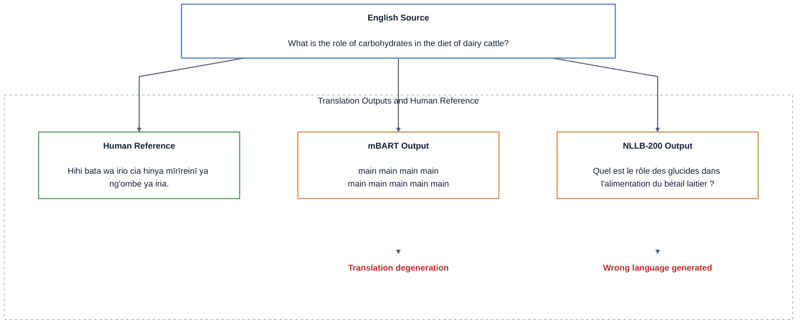

# Intuition

This Mermaid flowchart places the model-specific observations outside and beneath their corresponding output boxes, styled in red. A white background is explicitly set for the diagram and its nodes.

