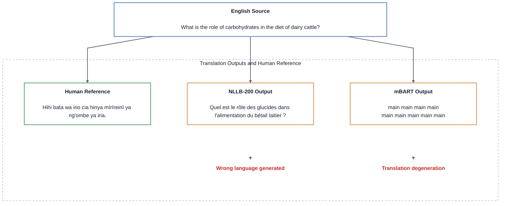
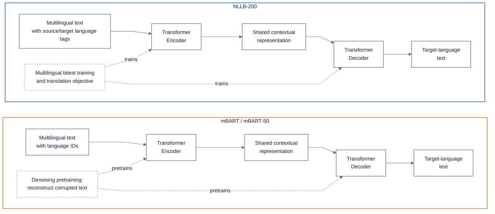

# Intuition: Why Zero-Shot Translation Can Fail

The examples below compare two model outputs with a human reference. Their output boxes are ordered **mBART, then NLLB-200**; each red observation sits outside and directly beneath its corresponding model output. A white background is specified for the Mermaid diagrams.

## Model Architecture (Conceptual)

Both models use multilingual sequence-to-sequence Transformer encoder-decoder architectures. This simplified diagram highlights their different multilingual training setups; it is not a layer-by-layer specification.

## Model Comparison

| Model family / commonly used checkpoint | Languages covered | Approximate parameters | Training and practical context |
|---|---:|---:|---|
| [mBART-50](https://huggingface.co/facebook/mbart-large-50-many-to-many-mmt) | 50 | About 610M | Multilingual denoising-pretrained encoder-decoder; the many-to-many checkpoint was fine-tuned for translation across its supported language set. The original mBART-CC25 setup covered 25 languages. |
| [NLLB-200](https://huggingface.co/facebook/nllb-200-3.3B) | 200 | Public checkpoints include 600M (distilled), 1.3B, and 3.3B | Multilingual translation-focused encoder-decoder family trained for broad many-to-many coverage. Use the exact checkpoint's model card to verify its languages and limitations. |

*Parameter counts are checkpoint-specific and approximate. “mBART” and “NLLB-200” each refer to model families, not one single-size model. Language coverage means a language is included in the model's supported set; it does not guarantee equal quality for every language pair or direction.*

## Why Zero-Shot Can Fail

Zero-shot translation asks a model to translate a language pair without direct parallel examples for that exact pair during training or fine-tuning. Shared multilingual representations can enable transfer between languages, but transfer is not guaranteed. If a language is absent from the model's vocabulary or training data—or has sparse, noisy, or mismatched examples—the model may produce the wrong language, repetitive text, or a fluent but inaccurate translation. A large language-count headline alone does not ensure support for a particular language or pair.

For this example, the NLLB-200 output is French rather than the Kikuyu human reference, while mBART degenerates into repeated text. Check the exact checkpoint's supported-language list, the requested source and target language codes, and whether that direction is supported before attributing the result solely to model size or architecture.
