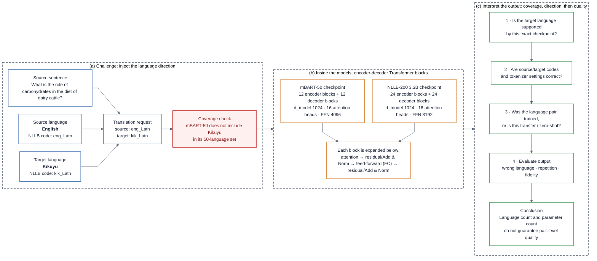

# Intuition 3: Diagnosing Zero-Shot Translation

A three-panel, presentation-oriented view inspired by the shared reference: **(a)** inject the source and target languages explicitly, **(b)** show the actual encoder/decoder sublayers for named checkpoints, and **(c)** diagnose unsupported-language and zero-shot behavior. The architecture drawings are schematic, but their stated layer counts and dimensions are tied to the checkpoints named below—not to every model in either family.

## Three-panel overview

## Detailed architecture diagrams

The diagrams expand one encoder block and one decoder block, then annotate how many times each block is repeated in the specified checkpoint. **MHA** means multi-head attention; **FC** means fully connected (feed-forward) layer. Residual connections and layer normalization are shown as Add & Norm. Embeddings include learned positional representations. This is the standard Transformer sequence-to-sequence layout used by these checkpoints; it is not intended to depict every implementation detail such as dropout placement or parameter sharing.

### mBART-50 many-to-many checkpoint

The source and target language IDs are part of the multilingual sequence formatting. mBART-50 supports 50 languages; Kikuyu is not one of them, so `kik_Latn` is not a supported mBART-50 target code.

```mermaid
%%{init: {"theme":"base","themeVariables":{"background":"#ffffff","mainBkg":"#ffffff","primaryColor":"#ffffff","primaryTextColor":"#172033","lineColor":"#596579","fontSize":"13px"},"flowchart":{"htmlLabels":true,"curve":"linear","nodeSpacing":22,"rankSpacing":32}}}%%
flowchart LR
    M_SRC(["Source text<br/>English"]) --> M_SRC_ID["Prepend source ID<br/><b>en_XX</b>"] --> M_TOK["SentencePiece<br/>token IDs"] --> M_EMB["Token + position<br/>embeddings"]

    subgraph M_ENCODER["mBART-50 encoder · repeat this block 12×"]
        direction LR
        M_ES["Encoder input"] --> M_EATT{{"Multi-head<br/>self-attention<br/>16 heads"}} --> M_EADD(["Add & Norm"])
        M_EADD --> M_FC1[["FC 1024 → 4096"]] --> M_ACT["GELU"] --> M_FC2[["FC 4096 → 1024"]] --> M_ENORM(["Add & Norm"])
    end
    M_EMB --> M_ES

    subgraph M_DECODER["mBART-50 decoder · repeat this block 12×"]
        direction LR
        M_DS["Target prefix<br/>+ target ID"] --> M_DATT{{"Masked multi-head<br/>self-attention<br/>16 heads"}} --> M_DADD(["Add & Norm"])
        M_DADD --> M_XATT{{"Encoder-decoder<br/>cross-attention<br/>16 heads"}} --> M_XADD(["Add & Norm"])
        M_XADD --> M_DFC1[["FC 1024 → 4096"]] --> M_DACT["GELU"] --> M_DFC2[["FC 4096 → 1024"]] --> M_DNORM(["Add & Norm"])
    end
    M_ENORM --> M_DS
    M_ENORM -. "encoder memory (keys/values)" .-> M_XATT
    M_DNORM --> M_LM[["Vocabulary projection<br/>→ token probabilities"]] --> M_TGT(["Generated target text"])

    classDef data fill:#ffffff,stroke:#4a78b5,color:#172033,stroke-width:1.5px;
    classDef attention fill:#eaf1fb,stroke:#4a78b5,color:#172033,stroke-width:2px;
    classDef dense fill:#fff3e6,stroke:#d98a42,color:#172033,stroke-width:1.5px;
    classDef norm fill:#f1f3f5,stroke:#737b88,color:#172033,stroke-width:1.2px;
    class M_SRC,M_SRC_ID,M_TOK,M_EMB,M_DS,M_TGT data;
    class M_EATT,M_DATT,M_XATT attention;
    class M_FC1,M_FC2,M_DFC1,M_DFC2,M_LM dense;
    class M_EADD,M_ENORM,M_DADD,M_XADD,M_DNORM norm;
    style M_ENCODER fill:#ffffff,stroke:#d98a42,stroke-width:2px
    style M_DECODER fill:#ffffff,stroke:#d98a42,stroke-width:2px
```

### NLLB-200 3.3B checkpoint

NLLB marks the requested direction with source and target language codes (for example, `eng_Latn` and `kik_Latn`). The 3.3B checkpoint has 24 encoder and 24 decoder layers. The NLLB-200 family includes Kikuyu, but language inclusion alone does not ensure high-quality output for every direction.

```mermaid
%%{init: {"theme":"base","themeVariables":{"background":"#ffffff","mainBkg":"#ffffff","primaryColor":"#ffffff","primaryTextColor":"#172033","lineColor":"#596579","fontSize":"13px"},"flowchart":{"htmlLabels":true,"curve":"linear","nodeSpacing":22,"rankSpacing":32}}}%%
flowchart LR
    N_SRC(["Source text<br/>English"]) --> N_SRC_ID["Source language ID<br/><b>eng_Latn</b>"] --> N_TOK["SentencePiece<br/>token IDs"] --> N_EMB["Token + position<br/>embeddings"]

    subgraph N_ENCODER["NLLB-200 3.3B encoder · repeat this block 24×"]
        direction LR
        N_ES["Encoder input"] --> N_EATT{{"Multi-head<br/>self-attention<br/>16 heads"}} --> N_EADD(["Add & Norm"])
        N_EADD --> N_FC1[["FC 1024 → 8192"]] --> N_ACT["ReLU"] --> N_FC2[["FC 8192 → 1024"]] --> N_ENORM(["Add & Norm"])
    end
    N_EMB --> N_ES

    subgraph N_DECODER["NLLB-200 3.3B decoder · repeat this block 24×"]
        direction LR
        N_DS["Target prefix<br/>+ target ID"] --> N_DATT{{"Masked multi-head<br/>self-attention<br/>16 heads"}} --> N_DADD(["Add & Norm"])
        N_DADD --> N_XATT{{"Encoder-decoder<br/>cross-attention<br/>16 heads"}} --> N_XADD(["Add & Norm"])
        N_XADD --> N_DFC1[["FC 1024 → 8192"]] --> N_DACT["ReLU"] --> N_DFC2[["FC 8192 → 1024"]] --> N_DNORM(["Add & Norm"])
    end
    N_ENORM --> N_DS
    N_ENORM -. "encoder memory (keys/values)" .-> N_XATT
    N_TGT_ID["Target language ID<br/><b>kik_Latn</b>"] --> N_DS
    N_DNORM --> N_LM[["Vocabulary projection<br/>→ token probabilities"]] --> N_TGT(["Generated Kikuyu text"])

    classDef data fill:#ffffff,stroke:#4a78b5,color:#172033,stroke-width:1.5px;
    classDef attention fill:#eaf1fb,stroke:#4a78b5,color:#172033,stroke-width:2px;
    classDef dense fill:#fff3e6,stroke:#d98a42,color:#172033,stroke-width:1.5px;
    classDef norm fill:#f1f3f5,stroke:#737b88,color:#172033,stroke-width:1.2px;
    class N_SRC,N_SRC_ID,N_TOK,N_EMB,N_DS,N_TGT_ID,N_TGT data;
    class N_EATT,N_DATT,N_XATT attention;
    class N_FC1,N_FC2,N_DFC1,N_DFC2,N_LM dense;
    class N_EADD,N_ENORM,N_DADD,N_XADD,N_DNORM norm;
    style N_ENCODER fill:#ffffff,stroke:#4a78b5,stroke-width:2px
    style N_DECODER fill:#ffffff,stroke:#4a78b5,stroke-width:2px
```

## Checkpoint comparison

| Named checkpoint | Languages in family/checkpoint | Parameters (approx.) | Encoder / decoder layers | Model width / attention / FFN width |
|---|---:|---:|---:|---|
| [mBART-50 many-to-many](https://huggingface.co/facebook/mbart-large-50-many-to-many-mmt) | 50 | 610M | 12 / 12 | 1024 / 16 heads / 4096 |
| [NLLB-200 3.3B](https://huggingface.co/facebook/nllb-200-3.3B) | 200 | 3.3B | 24 / 24 | 1024 / 16 heads / 8192 |

*These values are checkpoint-specific. NLLB-200 also has smaller checkpoints, including distilled 600M and 1.3B models, with different configurations. Consult the exact checkpoint configuration when reproducing an experiment.*

## Reading this example

The NLLB-200 example generates French even though the requested reference is Kikuyu; the mBART example repeats “main.” These are observed outputs, not proof by themselves of a particular architectural cause. Before attributing failure to zero-shot transfer, confirm the model checkpoint, tokenizer, source/target IDs, decoding settings, and evaluation reference. In particular, mBART-50 does not support Kikuyu, whereas NLLB-200 includes Kikuyu; neither a larger parameter count nor a larger language count guarantees reliable translation for every language pair.

## References

- [mBART-50 many-to-many model card](https://huggingface.co/facebook/mbart-large-50-many-to-many-mmt)
- [mBART-50 configuration](https://huggingface.co/facebook/mbart-large-50-many-to-many-mmt/blob/main/config.json)
- [NLLB-200 3.3B model card](https://huggingface.co/facebook/nllb-200-3.3B)
- [NLLB-200 3.3B configuration](https://huggingface.co/facebook/nllb-200-3.3B/blob/main/config.json)
- Tang et al., [Multilingual Translation with Extensible Multilingual Pretraining and Finetuning](https://arxiv.org/abs/2008.00401) (mBART)
- NLLB Team et al., [No Language Left Behind: Scaling Human-Centered Machine Translation](https://arxiv.org/abs/2207.04672) (NLLB)
