# Intuition 3: Diagnosing Zero-Shot Translation

A presentation-oriented, three-panel infographic: **(a)** explicit source/target language injection, **(b)** detailed encoder-decoder Transformer architecture for named checkpoints, and **(c)** a diagnostic path for interpreting zero-shot outputs. The layout and visual language are inspired by the shared reference. Architectural blocks are schematic; checkpoint-specific depths and dimensions are indicated explicitly.

## Three-panel overview

```mermaid
%%{init: {"theme":"base","themeVariables":{"background":"#ffffff","mainBkg":"#ffffff","primaryColor":"#ffffff","primaryTextColor":"#172033","lineColor":"#596579","fontSize":"14px"},"flowchart":{"htmlLabels":true,"curve":"linear","nodeSpacing":22,"rankSpacing":30}}}%%
flowchart LR
    subgraph A["(a) Challenge: inject the language direction"]
        direction TB
        A_TXT["Source sentence<br/>What is the role of carbohydrates in the diet of dairy cattle?"]
        A_SRC["Source language<br/><b>English</b><br/>NLLB: eng_Latn"]
        A_TGT["Target language<br/><b>Kikuyu</b><br/>NLLB: kik_Latn"]
        A_PACK["Tokenized request<br/>source text + source ID<br/>target ID"]
        A_TXT --> A_PACK
        A_SRC --> A_PACK
        A_TGT --> A_PACK
        A_COVER["Coverage matters<br/>Kikuyu is outside mBART-50's<br/>50-language set"]
        A_PACK --> A_COVER
    end

    subgraph B["(b) Model internals: repeated attention and feed-forward layers"]
        direction TB
        B_IN["Language-tagged input tokens"] --> B_ENC{{"ENCODER STACK<br/>mBART-50: 12 blocks<br/>NLLB-200 3.3B: 24 blocks"}} --> B_MEM[("Contextual encoder memory")]
        B_MEM --> B_XATT{{"Decoder cross-attention<br/>reads encoder memory"}} --> B_FF[["Feed-forward / FC layers"]] --> B_OUT["Vocabulary projection<br/>next-token probabilities"]
        B_PREFIX["Target prefix + target ID"] --> B_SELF{{"Masked decoder<br/>self-attention"}} --> B_XATT
        B_NOTE["Each Transformer block contains multi-head attention,<br/>residual + normalization, two fully connected layers, activation,<br/>and a second residual + normalization stage."]
        B_ENC -. "block detail" .-> B_NOTE
        B_XATT -. "block detail" .-> B_NOTE
    end

    subgraph C["(c) Interpretation: verify coverage before diagnosing failure"]
        direction TB
        C1["1 · Check checkpoint support<br/>Is the target language included?"] --> C2["2 · Verify language IDs<br/>and tokenizer configuration"]
        C2 --> C3["3 · Check direction and training evidence<br/>Was this pair seen, or is transfer required?"]
        C3 --> C4["4 · Evaluate generated output<br/>language · repetition · fidelity"]
        C4 --> C5["Conclusion<br/>Language count and model size<br/>do not guarantee pair-level quality"]
    end

    A_COVER --> B_IN
    B_OUT --> C1

    classDef data fill:#ffffff,stroke:#4a78b5,color:#172033,stroke-width:1.5px;
    classDef attention fill:#eaf1fb,stroke:#4a78b5,color:#172033,stroke-width:2px;
    classDef dense fill:#fff3e6,stroke:#d98a42,color:#172033,stroke-width:1.5px;
    classDef diagnostic fill:#edf6ed,stroke:#4d9b61,color:#172033,stroke-width:1.5px;
    classDef caution fill:#fff0f0,stroke:#c62828,color:#8f1d1d,stroke-width:1.5px;
    class A_TXT,A_SRC,A_TGT,A_PACK,B_IN,B_PREFIX,B_OUT data;
    class B_ENC,B_XATT,B_SELF attention;
    class B_FF dense;
    class B_MEM,B_NOTE diagnostic;
    class A_COVER caution;
    class C1,C2,C3,C4,C5 diagnostic;
    style A fill:#ffffff,stroke:#737b88,stroke-width:2px,stroke-dasharray:6 4
    style B fill:#ffffff,stroke:#737b88,stroke-width:2px,stroke-dasharray:6 4
    style C fill:#ffffff,stroke:#737b88,stroke-width:2px,stroke-dasharray:6 4
```

## Detailed architecture: mBART-50 and NLLB-200

The detailed diagrams use a horizontal, paper-style flow: language-tagged inputs, an encoder stack, an encoder-to-decoder attention connection, and an autoregressive decoder stack. Hexagons mark attention operations, rounded capsules mark residual/Add & Norm stages, and orange boxes mark fully connected (feed-forward) layers. Each drawn encoder/decoder block is repeated to the checkpoint depth shown in its label.

**Block notation:** MHA = multi-head attention; FFN = position-wise feed-forward network; FC = fully connected layer; Add & Norm = residual addition followed by layer normalization. Inside each decoder block, masked self-attention is followed by encoder-decoder cross-attention and an FFN.

### mBART-50 many-to-many checkpoint

mBART-50 uses a 12-layer encoder and 12-layer decoder, with model width 1024, 16 attention heads, and FFN width 4096. Its language IDs are represented with the mBART language-token convention (English: `en_XX`). **Kikuyu is not included in mBART-50's 50 languages**, so the model does not have a supported Kikuyu target ID.

```mermaid
%%{init: {"theme":"base","themeVariables":{"background":"#ffffff","mainBkg":"#ffffff","primaryColor":"#ffffff","primaryTextColor":"#172033","lineColor":"#596579","fontSize":"12px"},"flowchart":{"htmlLabels":true,"curve":"linear","nodeSpacing":18,"rankSpacing":26}}}%%
flowchart LR
    MS(["Source text<br/>English"]) --> MID["Prepend source ID<br/><b>en_XX</b>"] --> MTOK["SentencePiece<br/>token IDs"] --> MEMB["Token + position<br/>embeddings"]

    subgraph MENC["mBART-50 ENCODER · repeat block 12× · d=1024"]
        direction LR
        MEIN["Encoder input"] --> MEATT{{"Multi-head<br/>self-attention<br/><b>16 heads</b>"}} --> MEADD(["Add & Norm"])
        MEADD --> MEFC1[["FC<br/>1024 → 4096"]] --> MEGELU["GELU"] --> MEFC2[["FC<br/>4096 → 1024"]] --> MENORM(["Add & Norm"])
    end
    MEMB --> MEIN

    subgraph MDEC["mBART-50 DECODER · repeat block 12× · d=1024"]
        direction LR
        MDIN["Target prefix<br/>+ target ID"] --> MDATT{{"Masked multi-head<br/>self-attention<br/><b>16 heads</b>"}} --> MDADD(["Add & Norm"])
        MDADD --> MXATT{{"Encoder-decoder<br/>cross-attention<br/><b>16 heads</b>"}} --> MXADD(["Add & Norm"])
        MXADD --> MDFC1[["FC<br/>1024 → 4096"]] --> MDGELU["GELU"] --> MDFC2[["FC<br/>4096 → 1024"]] --> MDNORM(["Add & Norm"])
    end
    MENORM --> MDIN
    MENORM -. "encoder memory: keys / values" .-> MXATT
    MDNORM --> MLM[["Vocabulary projection"]] --> MOUT(["Next target token"])

    classDef token fill:#ffffff,stroke:#55789b,color:#172033,stroke-width:1.3px;
    classDef attn fill:#eaf1fb,stroke:#4a78b5,color:#172033,stroke-width:2px;
    classDef fc fill:#fff3e6,stroke:#d98a42,color:#172033,stroke-width:1.5px;
    classDef norm fill:#f1f3f5,stroke:#737b88,color:#172033,stroke-width:1.2px;
    class MS,MID,MTOK,MEMB,MEIN,MDIN,MOUT token;
    class MEATT,MDATT,MXATT attn;
    class MEFC1,MEFC2,MDFC1,MDFC2,MLM fc;
    class MEADD,MENORM,MDADD,MXADD,MDNORM norm;
    style MENC fill:#ffffff,stroke:#d98a42,stroke-width:2px
    style MDEC fill:#ffffff,stroke:#d98a42,stroke-width:2px
```

### NLLB-200 3.3B checkpoint

NLLB-200 3.3B uses a 24-layer encoder and 24-layer decoder, with model width 1024, 16 attention heads, and FFN width 8192. The direction is explicitly tagged with NLLB language codes: English `eng_Latn` → Kikuyu `kik_Latn`. Kikuyu is included in NLLB-200's supported-language set; that does not guarantee equal performance across directions.

```mermaid
%%{init: {"theme":"base","themeVariables":{"background":"#ffffff","mainBkg":"#ffffff","primaryColor":"#ffffff","primaryTextColor":"#172033","lineColor":"#596579","fontSize":"12px"},"flowchart":{"htmlLabels":true,"curve":"linear","nodeSpacing":18,"rankSpacing":26}}}%%
flowchart LR
    NS(["Source text<br/>English"]) --> NSID["Source language ID<br/><b>eng_Latn</b>"] --> NTOK["SentencePiece<br/>token IDs"] --> NEMB["Token + position<br/>embeddings"]

    subgraph NENC["NLLB-200 3.3B ENCODER · repeat block 24× · d=1024"]
        direction LR
        NEIN["Encoder input"] --> NEATT{{"Multi-head<br/>self-attention<br/><b>16 heads</b>"}} --> NEADD(["Add & Norm"])
        NEADD --> NEFC1[["FC<br/>1024 → 8192"]] --> NERELU["ReLU"] --> NEFC2[["FC<br/>8192 → 1024"]] --> NENORM(["Add & Norm"])
    end
    NEMB --> NEIN

    subgraph NDEC["NLLB-200 3.3B DECODER · repeat block 24× · d=1024"]
        direction LR
        NDIN["Target prefix<br/>+ target ID"] --> NDATT{{"Masked multi-head<br/>self-attention<br/><b>16 heads</b>"}} --> NDADD(["Add & Norm"])
        NDADD --> NXATT{{"Encoder-decoder<br/>cross-attention<br/><b>16 heads</b>"}} --> NXADD(["Add & Norm"])
        NXADD --> NDFC1[["FC<br/>1024 → 8192"]] --> NDRELU["ReLU"] --> NDFC2[["FC<br/>8192 → 1024"]] --> NDNORM(["Add & Norm"])
    end
    NENORM --> NDIN
    NENORM -. "encoder memory: keys / values" .-> NXATT
    NTID["Target language ID<br/><b>kik_Latn</b>"] --> NDIN
    NDNORM --> NLM[["Vocabulary projection"]] --> NOUT(["Next Kikuyu token"])

    classDef token fill:#ffffff,stroke:#55789b,color:#172033,stroke-width:1.3px;
    classDef attn fill:#eaf1fb,stroke:#4a78b5,color:#172033,stroke-width:2px;
    classDef fc fill:#fff3e6,stroke:#d98a42,color:#172033,stroke-width:1.5px;
    classDef norm fill:#f1f3f5,stroke:#737b88,color:#172033,stroke-width:1.2px;
    class NS,NSID,NTOK,NEMB,NEIN,NDIN,NTID,NOUT token;
    class NEATT,NDATT,NXATT attn;
    class NEFC1,NEFC2,NDFC1,NDFC2,NLM fc;
    class NEADD,NENORM,NDADD,NXADD,NDNORM norm;
    style NENC fill:#ffffff,stroke:#4a78b5,stroke-width:2px
    style NDEC fill:#ffffff,stroke:#4a78b5,stroke-width:2px
```

## Checkpoint comparison

| Named checkpoint | Languages | Parameters (approx.) | Encoder / decoder blocks | Model width / heads / FFN width |
|---|---:|---:|---:|---|
| [mBART-50 many-to-many](https://huggingface.co/facebook/mbart-large-50-many-to-many-mmt) | 50 | 610M | 12 / 12 | 1024 / 16 / 4096 |
| [NLLB-200 3.3B](https://huggingface.co/facebook/nllb-200-3.3B) | 200 | 3.3B | 24 / 24 | 1024 / 16 / 8192 |

*These figures refer to the named checkpoints. NLLB-200 also has smaller checkpoints, including distilled 600M and 1.3B variants with different model configurations. Verify the exact checkpoint configuration when reproducing an experiment.*

## Interpreting the example

The observed NLLB-200 output is French rather than the Kikuyu reference, while the mBART output repeats “main.” Those observations alone do not prove a specific architectural cause. Verify the checkpoint, tokenizer, source and target IDs, generation settings, and reference language. The contrast is useful: mBART-50 does not include Kikuyu, while NLLB-200 does, but language coverage is not a guarantee of pair-level quality. Zero-shot transfer may fail when a language or direction is unsupported or underrepresented, even if a model has many parameters or a large overall language count.

## References

- [mBART-50 many-to-many model card](https://huggingface.co/facebook/mbart-large-50-many-to-many-mmt)
- [mBART-50 configuration](https://huggingface.co/facebook/mbart-large-50-many-to-many-mmt/blob/main/config.json)
- [NLLB-200 3.3B model card](https://huggingface.co/facebook/nllb-200-3.3B)
- [NLLB-200 3.3B configuration](https://huggingface.co/facebook/nllb-200-3.3B/blob/main/config.json)
- Tang et al., [Multilingual Translation with Extensible Multilingual Pretraining and Finetuning](https://arxiv.org/abs/2008.00401) (mBART)
- NLLB Team et al., [No Language Left Behind: Scaling Human-Centered Machine Translation](https://arxiv.org/abs/2207.04672) (NLLB)
