# Retrieval-Augmented Generation Seminar

This diagram follows the architectural layout of the reference image: offline document indexing at the top and online retrieval and generation below.

```mermaid
%%{init: {"theme": "base", "themeVariables": {"fontFamily": "Georgia, serif", "fontSize": "18px", "primaryTextColor": "#172033", "lineColor": "#344054", "background": "#ffffff"}, "flowchart": {"curve": "basis", "htmlLabels": true, "nodeSpacing": 42, "rankSpacing": 52}}}%%
flowchart LR

  subgraph OFFLINE["1) Data Preparation &amp; Indexing (Offline)"]
    direction LR
    RAW["Raw Documents"]
    CHUNK["Chunking"]
    EMBED_DOC["Document<br/>Embeddings"]
    VECTOR[("Vector Database<br/>(Vector Index)")]

    RAW --> CHUNK --> EMBED_DOC --> VECTOR
  end

  subgraph ONLINE["2) Retrieval &amp; Generation (Online)"]
    direction LR
    QUERY_ICON["User Query"]
    QUERY_EMB["Query<br/>Embedding<br/>(Normalized)"]
    FILTER["(Optional)<br/>Metadata Filtering"]
    SEARCH["Similarity Search<br/>(Dense Vector Nearest Neighbor)"]
    RETRIEVE["Top-k Retrieved<br/>Documents"]
    RERANK["(Optional)<br/>Re-ranking"]
    CONTEXT["LLM with<br/>Augmented<br/>Context"]
    ANSWER["Generated<br/>Answer"]

    QUERY_ICON --> QUERY_EMB --> FILTER --> SEARCH --> RETRIEVE --> RERANK --> CONTEXT --> ANSWER
  end

  VECTOR -.-> SEARCH

  classDef stage fill:#fff8f1,stroke:#f2a86b,color:#172033,stroke-width:1.8px;
  classDef process fill:#f5efff,stroke:#9b72c4,color:#172033,stroke-width:1.8px;
  classDef storage fill:#edf6ff,stroke:#527da8,color:#172033,stroke-width:1.8px;
  classDef result fill:#fff8f1,stroke:#ef9a58,color:#172033,stroke-width:1.8px;

  class RAW,CHUNK,EMBED_DOC,QUERY_EMB stage;
  class FILTER,SEARCH,RERANK process;
  class VECTOR storage;
  class QUERY_ICON,RETRIEVE,CONTEXT,ANSWER result;

  style OFFLINE fill:#ffffff,stroke:#ffffff,stroke-width:0px,color:#172033
  style ONLINE fill:#ffffff,stroke:#ffffff,stroke-width:0px,color:#172033

  linkStyle default stroke:#344054,stroke-width:2.5px
```

## Pipeline Summary

### 1. Data Preparation and Indexing

1. **Raw Documents** are collected.
2. **Chunking** divides documents into searchable passages.
3. **Document Embeddings** convert passages into vector representations.
4. **Vector Database** stores vectors and enables similarity search.

### 2. Retrieval and Generation

1. **User Query** is embedded into the same vector space.
2. **Metadata Filtering** can narrow the search to relevant sources.
3. **Similarity Search** retrieves passages nearest to the query.
4. **Top-k Retrieved Documents** are selected.
5. **Re-ranking** can improve relevance and remove noisy passages.
6. Selected passages are combined with the query as augmented context for the **LLM**.
7. The **LLM** generates the final answer.
